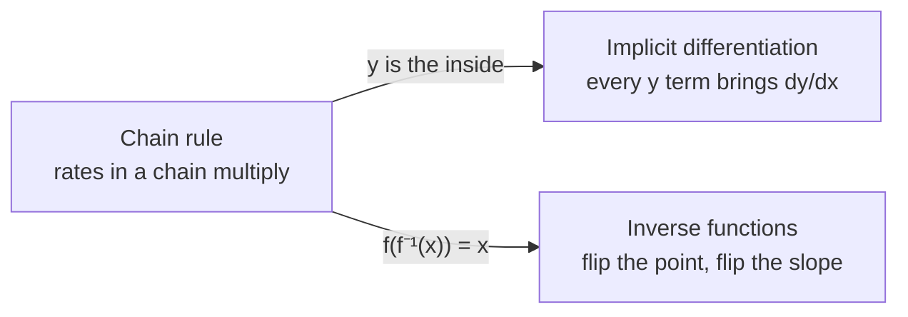
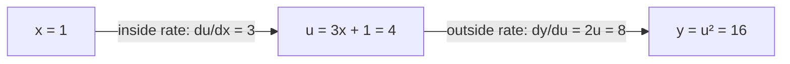
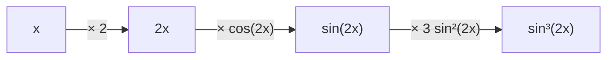

Thursday's quiz covers the **chain rule**, **implicit differentiation** and **derivatives of inverse functions**. They look like three topics, but they are one idea used three ways: when one quantity feeds into another, their rates of change multiply. If the chain rule makes sense to you, the other two are short add-ons.

By the end of this page, you will be able to take the derivative of a layered function, find the slope of a curve that is not solved for $y$, and find the slope of an inverse without ever writing the inverse down. The pictures are live, so drag the points and watch the numbers change as you read.

In this guide, we will (1) see the one idea behind all three topics, (2) build the chain rule from a tiny example and practice it on formulas and tables, (3) use it on equations where $y$ is hidden, (4) use it once more for inverse functions, and (5) finish with a summary and a practice quiz you can check as you go.

## One idea, three uses

In this section, we will get the big picture first, so that each later section has a place to hang.

Our running example is the circle $x^2 + y^2 = 25$ and its point $(3, 4)$, shown in figure 1. The red line just touches the circle at $(3, 4)$. It is the **tangent line**, and its slope is what "the derivative at that point" means. As we can see from the grid, it falls 3 units for every 4 units it moves right, so its slope is $-\tfrac{3}{4}$.

```plot
x: -6 to 6
y: -6 to 6
aspect: equal
implicit x^2 + y^2 = 25 "x² + y² = 25"
line through (3, 4) slope -3/4
point (3, 4) "(3, 4)" [outer]
caption: Figure 1. Our running example, the circle $x^2 + y^2 = 25$. The red tangent line touches it at $(3, 4)$ with slope $-\tfrac{3}{4}$. Every section of this page finds that same slope a different way.
```

We will reach that $-\tfrac{3}{4}$ three times, once per topic, and figure 2 shows how the three topics connect.



Now that we know where we are going, let's start with the idea everything else rests on.

## Chain rule

In this section, we will see why the chain rule multiplies rates, check it on a function we can also do the long way, and then practice it on formulas and tables.

### A tiny example first

Let's start small. Take $y = (3x + 1)^2$ at $x = 1$. You work it out in two steps: first the ++inside++, $u = 3x + 1$, then the ==outside==, $y = u^2$. Figure 3 shows this as a chain.



When $x$ moves a tiny bit, $u$ moves 3 times as far, because $u = 3x + 1$. When $u$ moves a tiny bit near 4, $y$ moves $2u = 8$ times as far, because $y = u^2$. So $y$ moves $8 \times 3 = 24$ times as far as $x$. The derivative is $24$.

Let's check that the long way. Expanding gives $y = 9x^2 + 6x + 1$, so $y' = 18x + 6$, which is $24$ at $x = 1$. The two answers match. As we can see, the chain rule is not a new rule to memorize; it is just "rates in a chain multiply", like gears: if gear A turns B 3 times as fast and B turns C 8 times as fast, C turns 24 times as fast as A.

### The rule

Here is the general version. Take the derivative of the ==outside== and leave the ++inside++ alone. Then multiply by the derivative of the ++inside++.

::: note The move
$$\frac{d}{dx}\,\color{orange}{f(}\color{teal}{g(x)}\color{orange}{)} = \color{orange}{f'(}\color{teal}{g(x)}\color{orange}{)}\cdot\color{teal}{g'(x)}$$

One factor per layer. The outside's rate is measured at the inside's current value, not at $x$.
:::

Now let's see it on our running example. The top half of the circle is $y = \sqrt{25 - x^2}$. The ==outside== is the square root, and the ++inside++ is $u = 25 - x^2$. Figure 4 lets you check the rule at any point: drag the red point and compare the product of the two rates with the actual slope of the red tangent line.

```plot
x: -1 to 6
y: -1 to 6
f(x) = sqrt(25 - x^2) "y = √(25 − x²)"
drag a on f from 0 to 4.8 = 3
tangent f at a
readout "inside $u = 25 - a^2$" 25 - a^2
readout "outside rate $\tfrac{1}{2\sqrt{u}}$" 1/(2sqrt(25 - a^2)) [digits=3]
readout "inside rate $-2a$" -2a
readout "product" -2a/(2sqrt(25 - a^2))
readout "slope of the red line" f'(a)
caption: Figure 4. The top half of the circle. The product of the outside rate and the inside rate always equals the slope of the tangent line. At $a = 3$ the inside is 16, the outside rate is $\tfrac{1}{8}$, the inside rate is $-6$, and the product is $-\tfrac{3}{4}$.
```

At $x = 3$, the inside is $25 - 9 = 16$, so the outside's rate there is $\dfrac{1}{2\sqrt{16}} = \dfrac{1}{8}$. The inside's rate is $-2x = -6$. Multiplying gives $\dfrac{1}{8}\cdot(-6) = -\dfrac{3}{4}$, the slope from figure 1. That is the first of our three times reaching it.

### How to spot it

Next, let's see how to tell when a problem needs the chain rule. You need it whenever the input to a function is anything other than plain $x$: parentheses raised to a power, a square root of something, something in an exponent, or something inside sin, cos or ln.

Watch where a power sits. $\sin^3(2x)$ means $\big[\sin(2x)\big]^3$, so the cube is the outermost layer.

::: check Which of these needs the chain rule?
- [ ] $x^5$
  The input to the power is plain $x$, so the power rule alone works: $5x^4$.
- [ ] $\sin(x)$
  The input to sine is plain $x$, so the derivative is just $\cos(x)$.
- [x] $\sin(x^5)$
- [ ] $5x$
  This is a constant times $x$, with no layers. Its derivative is 5.

The input to sine is $x^5$, not plain $x$. So we get $\cos(x^5)$ times the inside's derivative $5x^4$, which is $5x^4\cos(x^5)$.
:::

### Worked examples

Now let's apply the move to two quiz-style problems: one from a formula and one from a table. Try each step yourself before you reveal it.

Example 1 has three layers. Figure 5 shows them from the inside out, with the factor each layer adds.



::: steps Example 1. Find $y'$ for $y = \sin^3(2x)$.
Here $y'$ is short for $\dfrac{dy}{dx}$, the derivative of $y$.

1. **Name the layers.** From the outside in: cubing, then sine, then $2x$ (figure 5).
2. **Cube layer.** Bring down the 3, drop the power by one, and leave the inside alone: $3\sin^2(2x)$.
3. **Sine layer.** The derivative of sine is cosine, with $2x$ still inside: $\cos(2x)$.
4. **Last layer.** The derivative of $2x$ is 2.
5. **Multiply**, because rates in a chain multiply: $y' = 3\sin^2(2x)\cdot\cos(2x)\cdot 2 = 6\sin^2(2x)\cos(2x)$.

So the answer is $6\sin^2(2x)\cos(2x)$, one factor for each arrow in figure 5.
:::

Tables are a quiz favorite. They test the one part of the rule people skip: the outside's rate is read at the inside's value.

::: steps Example 2. Let $h(x) = f(g(x))$. Find $h'(1)$.
| $x$ | $f(x)$ | $f'(x)$ | $g(x)$ | $g'(x)$ |
|---|---|---|---|---|
| 1 | 3 | $-2$ | 2 | 5 |
| 2 | 4 | 7 | 1 | $-3$ |

1. **Write the rule first.** $h'(1) = f'(g(1))\cdot g'(1)$. This line earns credit by itself.
2. **Inside first.** We need to know what the inside hands the outside. The table says $g(1) = 2$.
3. **Outside's rate at that value.** The outside's input is 2, so use $f'(2) = 7$, not $f'(1)$.
4. **Inside's rate.** $g'(1) = 5$.
5. **Multiply.** $h'(1) = 7\cdot 5 = 35$.

Note that the 2 we read from the $g$ column decided which row of $f'$ we used.
:::

### Traps

Each trap below skips or changes one piece of the move. The first is the most common, so let's see it in a picture. In figure 6, the slider sets $k$ in $y = \sin(kx)$. Watch the slope of the tangent at $x = 0$: it is always $k$, because the inside $kx$ adds a factor of $k$.

```plot
x: -3.2 to 3.2
y: -1.6 to 1.6
slider k from 0.5 to 3 = 1 step 0.1 "inside speed $k$"
f(x) = sin(k x) "y = sin(kx)"
tangent f at 0
readout "slope at $x = 0$" f'(0)
caption: Figure 6. A faster inside makes a steeper curve. The derivative of $\sin(kx)$ is $k\cos(kx)$, so the slope at 0 is $k\cos(0) = k$. Leaving out the inside's derivative would give slope 1 for every $k$.
```

:::: compare Forgetting the inside derivative
::: wrong
$\dfrac{d}{dx}\sin(5x) = \cos(5x)$
:::
::: right
The inside $5x$ adds a factor of 5: $5\cos(5x)$
:::
::::

:::: compare Feeding the outside the wrong number
::: wrong
In Example 2, $f'(1)\cdot g'(1) = -10$. Quizzes list this as a wrong choice on purpose.
:::
::: right
The outside gets the inside's value: $f'(2)\cdot g'(1) = 35$
:::
::::

:::: compare Stopping one layer early
::: wrong
$\dfrac{d}{dx}\sin^3(2x) = 3\sin^2(2x)\cos(2x)$
:::
::: right
The $2x$ layer still owes a factor of 2: $6\sin^2(2x)\cos(2x)$
:::
::::

Now that we can peel layers off a function of $x$, next we'll use the same move on equations where $y$ itself is the inside.

## Implicit differentiation

In this section, we will use the chain rule on equations that mix $x$ and $y$, starting with the full version of our running circle.

### A tiny example first

Let's say we know $y = x^3$, and we want the derivative of $y^2$. There are two ways.

1. **Plug in first.** $y^2 = x^6$, so its derivative is $6x^5$.
2. **Chain rule.** $y^2$ has layers: the square is the ==outside== and $y$ is the ++inside++. The outside's rate is $2y$, and the inside's rate is $\dfrac{dy}{dx} = 3x^2$. Multiplying gives $2y\cdot 3x^2 = 2x^3\cdot 3x^2 = 6x^5$.

Both give $6x^5$. The second way never needed to know what $y$ was until the very end; it just wrote $2y\dfrac{dy}{dx}$. That is the whole trick of implicit differentiation: treat $y$ as a function of $x$ you cannot see, and let the chain rule attach $\dfrac{dy}{dx}$ to it.

### The circle, all at once

A circle like $x^2 + y^2 = 25$ is not written as "$y =$ something", and it is not even a function (most $x$ values have two points). But near any one point it is a smooth curve with a slope. Let's take the derivative of both sides, attaching $\dfrac{dy}{dx}$ to the $y$ term:

$$2x + 2y\frac{dy}{dx} = 0 \quad\Longrightarrow\quad \frac{dy}{dx} = -\frac{x}{y}$$

At $(3, 4)$, that is $-\tfrac{3}{4}$ again, the second time we've reached it. Figure 7 lets you test the formula all the way around. Drag the point and watch where the slope is zero and where it is undefined.

```plot
x: -6.5 to 6.5
y: -6 to 6
aspect: equal
parametric (5cos(t), 5sin(t)) for t from 0 to 2pi
drag t on (5cos(t), 5sin(t)) from 0 to 2pi = atan(4/3)
line through (5cos(t), 5sin(t)) slope -cos(t)/sin(t)
readout "$x$" 5cos(t)
readout "$y$" 5sin(t)
readout "slope $-\tfrac{x}{y}$" -cos(t)/sin(t)
caption: Figure 7. The whole circle $x^2 + y^2 = 25$ with its tangent line. The slope $-\tfrac{x}{y}$ is 0 at the top and bottom, where the top of the fraction is zero, and undefined at the far left and right, where the bottom is zero and the tangent is vertical.
```

As we can see, the slope fraction tells us more than the slope at one point. When its top is zero, the tangent is **horizontal**. When its bottom is zero, the tangent is **vertical**.

### How to spot it

Next, let's see when a problem calls for this. The signs are that $x$ and $y$ are mixed together in one equation, and you are asked for $\dfrac{dy}{dx}$, a tangent line at a point, or where the tangent is horizontal or vertical.

::: note The move
Take the derivative of both sides. Attach $\dfrac{dy}{dx}$ to every $y$ term, and use the product rule on terms like $xy$. Then gather the $\dfrac{dy}{dx}$ terms on one side, factor it out, and divide.
:::

A condition like "$x = 0$" describes a whole line, so plug it back into the curve to get the actual points.

### Worked examples

Let's work through two examples: the running circle, then a curve with an $xy$ term.

::: steps Example 3. For $x^2 + y^2 = 25$, find the tangent line at $(3, 4)$ and the points where the tangent is horizontal.
1. **Take the derivative of both sides.** $x^2$ gives $2x$. $y^2$ gives $2y$ plus its tag-along $\dfrac{dy}{dx}$. The 25 is a constant, so it gives 0: $2x + 2y\dfrac{dy}{dx} = 0$.
2. **Solve for the slope.** Move $2x$ over and divide by $2y$: $\dfrac{dy}{dx} = -\dfrac{x}{y}$.
3. **Plug in both coordinates**, since the slope depends on $x$ and $y$. At $(3, 4)$ it is $-\dfrac{3}{4}$, so the line is $y - 4 = -\dfrac{3}{4}(x - 3)$.
4. **Horizontal means the top is zero.** That happens when $x = 0$. Putting $x = 0$ into the circle gives $y^2 = 25$, so the points are $(0, 5)$ and $(0, -5)$.

You can see both answers in figure 7: drag the point to the top or bottom of the circle and the slope reads 0.
:::

Example 4 adds a product. Figure 8 shows the curve, which is a tilted oval, and the tangent line we are about to find.

```plot
x: -4 to 4
y: -4 to 4
aspect: equal
implicit x^2 + x*y + y^2 = 7 "x² + xy + y² = 7"
line through (1, 2) slope -4/5
point (1, 2) "(1, 2)" [outer]
caption: Figure 8. The curve $x^2 + xy + y^2 = 7$. Its tangent line at $(1, 2)$ falls 4 units for every 5 units it moves right.
```

::: steps Example 4. Find the slope of $x^2 + xy + y^2 = 7$ at $(1, 2)$.
1. **Take the derivative of both sides.** $xy$ is a product of two things that both change, so it gives $y + x\dfrac{dy}{dx}$. The full line is $2x + y + x\dfrac{dy}{dx} + 2y\dfrac{dy}{dx} = 0$.
2. **Gather and factor.** Move the terms without $\dfrac{dy}{dx}$ to the other side: $\dfrac{dy}{dx}(x + 2y) = -(2x + y)$.
3. **Divide, then plug in both coordinates.** $\dfrac{dy}{dx} = -\dfrac{2x + y}{x + 2y} = -\dfrac{2 + 2}{1 + 4} = -\dfrac{4}{5}$ at $(1, 2)$.

So at $(1, 2)$, this curve falls 4 units for every 5 units it moves right, which is the red line in figure 8.
:::

### Traps

As before, each trap pairs a wrong answer with the right one.

:::: compare The missing dy/dx, the number one lost point
::: wrong
$\dfrac{d}{dx}(y^2) = 2y$
:::
::: right
$y$ is the inside, so its derivative tags along: $2y\dfrac{dy}{dx}$
:::
::::

:::: compare Skipping the product rule on xy
::: wrong
$\dfrac{d}{dx}(xy) = \dfrac{dy}{dx}$
:::
::: right
Both factors change, so use the product rule: $y + x\dfrac{dy}{dx}$
:::
::::

:::: compare Stopping at the condition
::: wrong
"Horizontal when $y = -2x$." That is a whole line, not a point.
:::
::: right
Put $y = -2x$ back into the curve and solve for the points.
:::
::::

::: check What is $\dfrac{d}{dx}\big(e^{y}\big)$?
- [ ] $e^{y}$
  That treats $y$ like plain $x$. But $y$ is the inside here, so its rate has to come along.
- [x] $e^{y}\dfrac{dy}{dx}$
- [ ] $y\,e^{y-1}$
  That uses the power rule, but $y$ is in the exponent, not the base.

The outside $e^{(\,)}$ copies itself, and the inside $y$ adds its rate $\dfrac{dy}{dx}$.
:::

We have now used the chain rule on a hidden $y$. Next, we'll use it one last time to find the slope of a function we can only undo, not write down.

## Derivatives of inverse functions

In this section, we will see why the slope of an inverse is a reciprocal, and how to find it from a formula or a table.

### A tiny example first

Let's start with $f(x) = 2x$. It doubles, so its inverse halves: $f^{-1}(x) = \tfrac{x}{2}$. The slope of $f$ is 2 and the slope of $f^{-1}$ is $\tfrac{1}{2}$. The inverse's slope is the reciprocal.

Why? An inverse undoes the original: if $f$ sends 1 to 4, then $f^{-1}$ sends 4 back to 1. Its graph is the original flipped across the line $y = x$, so every point $(a, b)$ becomes $(b, a)$. The flip swaps rise and run, and swapping rise and run turns a slope into its reciprocal.

The chain rule says the same thing. Since $f(f^{-1}(x)) = x$, taking the derivative of both sides gives $f'(f^{-1}(x))\cdot (f^{-1})'(x) = 1$, and dividing gives the rule below.

### The move

The catch is that the reciprocal has to be of the slope **at the matching point**. You never need a formula for $f^{-1}$. You only need one point and one slope.

::: note The move
Flip the point, then flip the slope.

$$\left(f^{-1}\right)'(a) = \frac{1}{f'\big(\color{teal}{f^{-1}(a)}\big)}$$

To find the matching point, solve $f(x) = a$. Quizzes make this work by guessing, so try 0, 1, $-1$ and 2.
:::

Figure 9 shows the flip for $f(x) = x^3 + 2x + 1$, the function in Example 5. Drag the black-curve point and watch its mirror image on the blue inverse.

```plot
x: -3 to 5
y: -3 to 5
aspect: equal
y = x "y = x" [muted dashed thin]
f(x) = x^3 + 2x + 1 "f"
inverse f "f⁻¹" [inner]
drag a on f from -1.2 to 1.15 = 1
tangent f at a
segment (a, f(a)) to (f(a), a) [muted dashed thin]
line through (f(a), a) slope 1/f'(a) [inner]
point (f(a), a) [inner]
readout "$a$" a
readout "$f(a)$" f(a)
readout "slope of $f$ at $a$" f'(a)
readout "slope of $f^{-1}$ at $f(a)$" 1/f'(a) [digits=3]
caption: Figure 9. The function $f(x) = x^3 + 2x + 1$ (black) and its inverse (blue), mirror images across the dashed line $y = x$. The point $(a, f(a))$ on $f$ flips to $(f(a), a)$ on $f^{-1}$, and the slope flips to its reciprocal. At $a = 1$, $f$ sends 1 to 4 with slope 5, so $f^{-1}$ has slope $\tfrac{1}{5}$ at 4.
```

Our running example works the same way. For $x$ between 0 and 5, the top half $f(x) = \sqrt{25 - x^2}$ sends 3 to 4 with slope $-\tfrac{3}{4}$. Flipping across $y = x$ turns the point $(3, 4)$ into $(4, 3)$ and the slope into $-\tfrac{4}{3}$, the third time our slope has shown up, this time upside down.

### How to spot it

Next, let's see how these problems usually look. You see $f^{-1}$, $\left(f^{-1}\right)'(a)$, or "$g$ is the inverse of $f$". Usually $f$ is something you could never undo by hand, like $x^3 + 2x + 1$.

### Worked examples

Let's do one example from a formula and one from a table.

::: steps Example 5. Let $f(x) = x^3 + 2x + 1$. Find $\left(f^{-1}\right)'(4)$.
1. **Find the matching point.** Which $x$ does $f$ send to 4? Try $x = 1$: $1 + 2 + 1 = 4$. So $f^{-1}(4) = 1$.
2. **Find the original slope there.** $f'(x) = 3x^2 + 2$, so $f'(1) = 5$.
3. **Flip it**, because the mirror swaps rise and run. The answer is $\dfrac{1}{5}$.

As we can see, we found the slope of $f^{-1}$ at 4 without ever undoing $x^3 + 2x + 1$. It is the blue slope in figure 9 at $a = 1$.
:::

::: steps Example 6. From a table, find $\left(f^{-1}\right)'(5)$.
| $x$ | 1 | 2 | 3 | 5 |
|---|---|---|---|---|
| $f(x)$ | 2 | 5 | 7 | 9 |
| $f'(x)$ | 3 | 4 | 6 | 2 |

1. **Find 5 among the outputs**, in the $f(x)$ row. It sits under $x = 2$, so $f^{-1}(5) = 2$.
2. **Read the slope in that column.** $f'(2) = 4$.
3. **Flip it.** The answer is $\dfrac{1}{4}$.

Note that the 5 we started with was an output of $f$, so we looked for it in the $f(x)$ row, not the $x$ row.
:::

### Traps

These two traps come from skipping one of the two flips.

:::: compare Plugging a straight into f prime
::: wrong
In Example 6, $\dfrac{1}{f'(5)} = \dfrac{1}{2}$, which used the $x = 5$ column.
:::
::: right
Find the matching point first, then flip: $\dfrac{1}{f'(2)} = \dfrac{1}{4}$
:::
::::

:::: compare Forgetting to flip
::: wrong
$\left(f^{-1}\right)'(4) = f'(1) = 5$
:::
::: right
The mirror swaps rise and run: $\dfrac{1}{f'(1)} = \dfrac{1}{5}$
:::
::::

We have now seen all three uses of the chain rule. Next, let's collect them in one place before the practice quiz.

## Summary

In this section, we restate each idea in one sentence, using our running circle where it helps.

::: takeaways
- **Chain rule:** The derivative is the outside's derivative with the inside left alone, times the inside's derivative, which gave $-\dfrac{3}{4}$ for the top half of the circle at $x = 3$; in a table, find the inside value first.
- **Implicit:** Because $y$ is a hidden inside, every $y$ term brings a $\dfrac{dy}{dx}$, and in the slope fraction a zero top means a horizontal tangent while a zero bottom means a vertical one.
- **Inverse:** To find the slope of an inverse, find the matching point on $f$ and then flip its slope, the way $-\dfrac{3}{4}$ at $(3, 4)$ became $-\dfrac{4}{3}$ at $(4, 3)$.
:::

Now that we have the three ideas in one place, let's test them on a practice quiz.

## Practice quiz

In this section, you'll try seven problems that mix all three ideas, the way the quiz will. No calculator. Pick an answer to check it; a wrong pick tells you which trap it was. Use this table for problems 2 and 7.

| $x$ | $f(x)$ | $f'(x)$ | $g(x)$ | $g'(x)$ |
|---|---|---|---|---|
| 1 | 4 | $-1$ | 3 | 2 |
| 2 | 1 | 5 | 1 | $-3$ |

::: check 1. $\dfrac{d}{dx}\sin^2(3x) =$
- [ ] $2\sin(3x)\cos(3x)$
  Close, but the $3x$ layer still owes a factor of 3.
- [x] $6\sin(3x)\cos(3x)$
- [ ] $6\sin(3x)$
  The sine layer's derivative, $\cos(3x)$, is missing.
- [ ] $6\cos(3x)$
  The square layer's factor, $2\sin(3x)$, became just 2.

The square, the sine and the $3x$ each give a factor: $2\sin(3x)\cdot\cos(3x)\cdot 3 = 6\sin(3x)\cos(3x)$.
:::

::: check 2. If $h(x) = f(g(x))$, then $h'(2) =$
- [x] $3$
- [ ] $-15$
  That used $f'(2) = 5$. The outside should get the inside's value, $g(2) = 1$.
- [ ] $-3$
  That is $g'(2)$ alone. The outside's rate is missing.
- [ ] $5$
  That is $f'(2)$, the outside's rate at the wrong input, with no inside factor.

Inside first: $g(2) = 1$. So $h'(2) = f'(1)\cdot g'(2) = (-1)(-3) = 3$.
:::

::: check 3. Find $\dfrac{dy}{dx}$ for $y = e^{\tan(4x)}$.
**Answer:** $4\sec^2(4x)\,e^{\tan(4x)}$. The $e$ layer copies itself, tangent gives $\sec^2(4x)$, and the $4x$ gives a 4.
:::

::: check 4. If $x^3 + y^3 = 6xy$, then $\dfrac{dy}{dx} =$
- [ ] $-x^2/y^2$
  That skipped the product rule on $6xy$ (treated the right side as a constant).
- [ ] $(x^2 - 2y)/(y^2 - 2x)$
  The signs on top are flipped. Check which side each term moved to.
- [x] $(2y - x^2)/(y^2 - 2x)$
- [ ] $(2y - x^2)/y^2$
  That dropped the $6x\dfrac{dy}{dx}$ term the product rule gives on the right side.

Taking derivatives gives $3x^2 + 3y^2\dfrac{dy}{dx} = 6y + 6x\dfrac{dy}{dx}$, with the product rule on $6xy$. Gathering gives $\dfrac{dy}{dx}(3y^2 - 6x) = 6y - 3x^2$, and dividing top and bottom by 3 gives C.
:::

::: check 5. Find all points on $x^2 - xy + y^2 = 3$ where the tangent line is horizontal.
**Answer:** $(1, 2)$ and $(-1, -2)$.

Taking derivatives gives $2x - y - x\dfrac{dy}{dx} + 2y\dfrac{dy}{dx} = 0$, so the slope is $\dfrac{y - 2x}{2y - x}$. The top is zero when $y = 2x$. Putting that into the curve gives $x^2 - 2x^2 + 4x^2 = 3x^2 = 3$, so $x = \pm 1$. The bottom, $2y - x = 3x$, is not zero there, so both points count.

```plot
x: -3 to 3
y: -3 to 3
aspect: equal
implicit x^2 - x*y + y^2 = 3
y = 2x [muted dashed thin]
line through (1, 2) slope 0
line through (-1, -2) slope 0
point (1, 2) "(1, 2)" [outer]
point (-1, -2) "(−1, −2)" [outer]
caption: Figure 10. The curve $x^2 - xy + y^2 = 3$. The dashed line $y = 2x$ is where the top of the slope fraction is zero; it crosses the curve at the two points with horizontal tangents.
```
:::

::: check 6. Let $f(x) = x^3 + x - 2$. Then $\left(f^{-1}\right)'(0) =$
- [ ] $1$
  That is $\dfrac{1}{f'(0)}$. The 0 is an output of $f$, so first find which input gives 0.
- [ ] $4$
  That is $f'(1)$ without the flip.
- [ ] $1/13$
  That is $\dfrac{1}{f'(2)}$. Check: $f(2) = 8$, not 0.
- [x] $1/4$

$f(1) = 1 + 1 - 2 = 0$, so the matching point is $x = 1$. Then $f'(1) = 3 + 1 = 4$, and flipping gives $\dfrac{1}{4}$.
:::

::: check 7. Using the table, $g$ is invertible. Find $\left(g^{-1}\right)'(1)$.
**Answer:** $-\dfrac{1}{3}$. The output 1 sits at $x = 2$ in the $g(x)$ column, so flip $g'(2) = -3$.
:::
