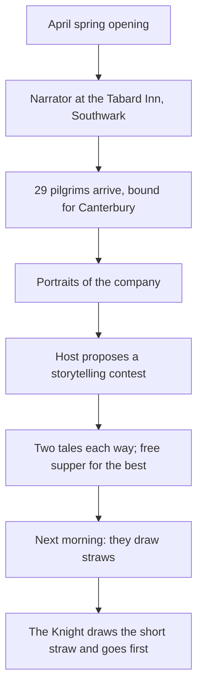

**The General Prologue** is the opening of Geoffrey Chaucer's *The Canterbury Tales*, written in *Middle English* (the English of the later Middle Ages) in the late 1300s. It is a *frame narrative*, a story that holds other stories inside it. In this frame, a mixed company of pilgrims meet at an inn, agree to a storytelling contest on the road to Canterbury, and are described one by one before the first tale begins.

Let's start with the first lines, in a close modern rendering of Chaucer's Middle English:

> When April with its sweet-smelling showers
> has pierced the drought of March to the root,
> and bathed every vein (of the plants) in such liquid
> by which power the flower is created...
> then folk long to go on pilgrimages.

Spring returns, and people feel the urge to travel. In England, Chaucer says, they especially head to Canterbury, to the shrine of the "holy blessed martyr" St. Thomas Becket, "who helped them when they were sick."[^harvard]

In this guide, we will (1) place the Prologue in context, (2) walk through what happens, (3) name the main ideas teachers look for, (4) meet every pilgrim in the order Chaucer introduces them, and (5) finish with a short self-check.

## What this is

Geoffrey Chaucer (c. 1340s-1400) wrote *The Canterbury Tales* in the late 1380s through 1400 and left the work unfinished. The General Prologue is its first part: 858 lines that set the scene, describe the travelers, and invent the contest that will frame the tales that follow.[^wp]

A *pilgrimage* is a journey to a holy place, often to give thanks or to seek help. Thomas Becket, Archbishop of Canterbury, was murdered in 1170 by knights of King Henry II and soon became England's most popular saint. His shrine at Canterbury Cathedral was a famous destination, and the trip from London was short enough that it could feel like both a religious journey and a spring outing.[^spark1]

The pilgrims represent a wide slice of fourteenth-century English society. Medieval social theory often divided people into three *estates*: those who fight (the nobility or military), those who pray (the clergy), and those who work (the commoners, sometimes called the laity). A work that measures people against the ideal of their estate, and often teases or attacks them for falling short, is called *estates satire*. The General Prologue is one of the most famous examples.[^spark1][^litcharts-themes]

Note that Chaucer the writer is not quite the same person as Chaucer the pilgrim. The narrator is a character in the story: friendly, easily impressed, and not always as sharp as the author who is putting the portraits on the page. That gap is where a lot of the comedy and criticism live. We will come back to it in the themes section.

## What happens

In this section, we will follow the Prologue from the April opening to the moment the Knight begins the first tale. Figure 1 lays out the whole path.

It is April. The narrator, already staying at the Tabard Inn in Southwark (just south of London, at the start of the road to Canterbury), is ready to go on pilgrimage "with a very devout spirit." That night, "well nine and twenty" travelers arrive by chance, all heading to Canterbury. He talks with them, joins their fellowship, and they agree to rise early the next day.[^harvard]

Before the journey starts, he pauses the story. He says it is reasonable to tell us the *condition*, *degree* (social rank), and *array* (clothing and gear) of each person, "as it seemed to him." The long series of portraits that follows is the heart of the Prologue.

After the portraits, the Host of the inn serves a supper, settles the bill, and proposes entertainment for the road. Each pilgrim will tell *two tales on the way to Canterbury and two more on the way home*. Whoever tells the tales of "best sentence and most solaas" (best moral meaning and most pleasure) will get a supper, paid for by the rest, back at the Tabard. The Host will ride with them at his own cost as guide, *governor*, judge, and scorekeeper. Anyone who disputes his judgment must pay the expenses of the trip. The company agrees, and they set a price for the prize supper.[^harvard][^spark4]

The next morning they ride out. After a mile or two, the Host has them draw straws (*draweth cut*) to see who tells the first tale. The Knight draws the short straw and prepares to begin.[^harvard]

A few details are easy to mix up, so let's pin them down:

- The narrator says 29 pilgrims came into the inn. He was already there, so the traveling company is those 29 plus himself. The Host later joins as guide, and is not usually counted in the 29.[^spark1]
- The portraits also mention "another nun" (the Second Nun) and "priests three" with the Prioress. If you count every person in the list, including those three priests, the headcount no longer matches "nine and twenty." That wrinkle is well known; if a question asks what the narrator *says*, the answer is 29 arrivals, plus the narrator.
- The plan is huge: two tales each way would have meant about 120 tales. The surviving *Canterbury Tales* never reach Canterbury, and not every pilgrim even tells one tale, which is one reason the work is called unfinished.[^litcharts]

## What it's about

Now that we have the plot, let's look at what the Prologue is doing. Teachers usually want you to talk about estates, corruption, irony, and the way clothes and bodies give the pilgrims away.

### The three estates

The portraits are arranged, roughly, from high rank to low. We start with the Knight and his household, move through the religious figures, then through prosperous town and professional people, and end with rougher characters and corrupt church officers.[^spark1]

The match is not a perfect ladder. The poor Parson and his brother the Plowman, two of the most admired people in the poem, appear late, after a run of worldly figures. The last cluster (Miller, Manciple, Reeve, Summoner, Pardoner) are people entrusted with other people's goods or with church business, and most of them abuse that trust.[^spark3]

When you compare a pilgrim with the ideal of their estate, you can usually hear Chaucer's judgment. The Knight, the Parson, the Plowman, and the Clerk come closest to the ideal. Many of the others are being measured and found wanting.

### Church corruption

Several religious figures have drifted far from their jobs. The Monk hunts and lives like a lord. The Friar gives easy confession for money and avoids the poor. The Summoner and the Pardoner, who work for the Church but are not parish priests, use their offices to cheat people. Set against them is the poor Parson, who visits his parishioners on foot and lives the teaching he preaches.[^spark2][^spark3]

The point is not "the Church is entirely bad." The point is contrast: Chaucer can praise a good priest in the same poem that savages a fraudulent pardoner.

### The naive narrator and irony

*Irony* here means a gap between what is said and what we are meant to understand. The narrator often praises a pilgrim in glowing terms, then drops in a detail that undercuts the praise: the Merchant is so impressive, and also in debt; the Physician is a great learned man, who hardly studies the Bible; the Friar is a "worthy" limiter, who knows every barmaid.[^spark2]

The narrator presents himself as a faithful reporter who will repeat what people said, even if it is rude, because "the word must be cousin to the deed." That pose lets Chaucer the author show us more than the pilgrim-narrator seems to notice.

### Appearance versus reality

Chaucer tells us he will describe each person's dress, and those details are rarely decoration. The Knight's tunic is stained by his armor; he has actually been in the field. The Squire's gown looks like a meadow sewn onto his clothes; he is a young courtly lover as well as a fighter. The Prioress's gold brooch says *Amor vincit omnia* ("Love conquers all"), a motto that can sound religious or romantic. The Pardoner's "relics" are a pillow-case and pigs' bones. If you can name the telling detail, you can usually name the character.

### Order, class, and "sentence and solaas"

The contest prize is not just "the funniest story." The Host wants tales with *sentence* (substance, moral meaning) and *solaas* (pleasure, entertainment). That pair is a useful key to the whole work: the pilgrimage is serious, and it is also a game. The same tension is already in the opening: spring stirs the body, and it also stirs people to seek a saint.[^litcharts]

## The pilgrims at a glance

Use this table to revise. The fuller portraits in the next section give the quiz details. "Praised" here means Chaucer presents the person close to an ideal; "satirized" means the portrait is comic, critical, or both. A few portraits are mixed or almost neutral.

| Pilgrim | Estate | One-line description | Stance |
|---|---|---|---|
| Knight | Nobility (military) | Veteran crusader; modest, courteous, actually battle-worn | Praised |
| Squire | Nobility (military) | The Knight's 20-year-old son; courtly lover, embroidered clothes | Mixed (youthful, a bit vain) |
| Yeoman | Nobility's household | Green-clad forester with a longbow and a St. Christopher badge | Mostly positive |
| Prioress (Madame Eglantine) | Clergy | Courtly nun with fine manners, little dogs, and an "Amor vincit omnia" brooch | Gentle satire |
| Second Nun and three priests | Clergy | Travel with the Prioress; almost no description in the Prologue | Undescribed |
| Monk | Clergy | Bald, fat hunter who shrugs off cloister rules | Satirized |
| Friar (Huberd) | Clergy | Jolly begging friar who sells easy penance and avoids lepers | Satirized |
| Merchant | Commoners (professional) | Forked beard, Flemish beaver hat; talks of profit and hides his debt | Satirized |
| Clerk of Oxford | Commoners (student) | Thin, threadbare scholar who would rather have books than money | Praised |
| Sergeant of the Law | Commoners (professional) | Able lawyer who seems even busier than he is | Gentle satire |
| Franklin | Commoners (landowner) | Wealthy, hospitable country gentleman; his house "snows" food and drink | Mixed |
| Five Guildsmen | Commoners (artisans) | Haberdasher, Carpenter, Weaver, Dyer, Tapestry-maker, in one livery | Satirized |
| Cook | Commoners (laborer) | Skilled cook with an open sore on his shin | Satirized |
| Shipman | Commoners (professional) | Tough Dartmouth sailor; steals wine and "sends" prisoners home by water | Satirized |
| Doctor of Physic | Commoners (professional) | Learned physician who loves gold and hardly reads the Bible | Satirized |
| Wife of Bath | Commoners | Well-off, widely traveled weaver; five husbands, gap-toothed, somewhat deaf | Mixed (vivid, satirical, and individualized) |
| Parson | Clergy | Poor village priest who first lives the Gospel he teaches | Praised |
| Plowman | Commoners (laborer) | The Parson's brother; hardworking, pays his tithes, loves God and neighbor | Praised |
| Miller | Commoners (steward) | Huge, wart-nosed wrestler who steals grain and plays the bagpipes | Satirized |
| Manciple | Commoners (steward) | Provisions-buyer for a law school; outsmarts the lawyers he feeds | Satirized |
| Reeve | Commoners (steward) | Thin, choleric estate manager who rides last and quietly grows rich | Satirized |
| Summoner | Church officer (lay) | Diseased-faced officer of the church court; sells pardons for sin | Satirized |
| Pardoner | Church officer (lay) | Smooth seller of fake relics and indulgences; yellow hair, goat-like voice | Satirized |
| Host | Innkeeper (not one of the 29) | Bold Tabard landlord who invents and judges the contest | Guide of the game |
| Narrator | Pilgrim | "Chaucer the pilgrim," a naive-seeming reporter in the company | Self-portrait |

## Portraits, in the order they appear

In this section, we will go pilgrim by pilgrim, in Chaucer's order, with the details that tend to show up on a quiz. Unless a note says otherwise, the facts below are from the General Prologue itself, not from later tales.[^harvard][^spark2][^spark3][^litcharts]

### The Knight, the Squire, and the Yeoman

**The Knight** is the first portrait, and the standard of the military estate. He loves chivalry, "truth and honour, freedom and courtesy." He has fought, and been honored, in Christian and non-Christian lands: Alexandria, Prussia, Lithuania, Russia, Granada (the siege of Algeciras), and other campaigns around the Mediterranean. He is "as meek as a maid" in his manners, never speaks villainy, and wears a simple tunic stained by his coat of mail. Chaucer presents him as the real thing: a veteran, not a show-off.

**The Squire** is the Knight's son, about twenty, a knight in training. He has fought in Flanders and northern France, but the portrait dwells on courtly love: curly hair, a short gown embroidered as if with a meadow of flowers, singing, fluting, dancing, drawing, and writing. He sleeps as little as a nightingale because of love, and he carves at the table for his father. He is courteous, but he is also young and a little vain. Set him next to his father: one is weathered service, the other is fashion and romance.

**The Yeoman** is their only servant on the trip, which already makes the Knight look modest. He is dressed in green, carries a well-kept bow and peacock-fletched arrows, plus a sword, a dagger, and a bright arm-guard. He wears a St. Christopher medal, and the narrator guesses from his gear that he is a forester.

### The Prioress and her companions

**The Prioress** is named Madame Eglantine (*madame Eglentyne*). She smiles simply, her strongest oath is "by Saint Loy," and she sings the liturgy through her nose. She speaks French "very well and elegantly, in the manner of Stratford at the Bow," but "French of Paris was to her unknown": it is convent-school French, not court French. The narrator spends a long time on her table manners (no morsel falls, no grease on the cup). She weeps for a trapped mouse and keeps small dogs, which she feeds roast meat, milk, and fine bread. She has a well-shaped nose, gray eyes, a small red mouth, and a broad forehead, and she is not thin. Her coral rosary has a gold brooch with a crowned A and the motto *Amor vincit omnia*, "Love conquers all." The satire is gentle: she is more like a court lady than a severe nun, and her charity is aimed at pets more than at the poor.

She is accompanied by **another nun**, her chaplain (the Second Nun), **and three priests**. The Prologue gives them no real portraits. Later in the Tales, a Second Nun and a Nun's Priest do tell stories, but that is outside the Prologue.

### The Monk and the Friar

**The Monk** is an *outrider*, a monk whose job takes him outside the monastery, and he loves hunting (*venerie*). His bridle jingles as loud as a chapel bell, a pointed image, because a chapel is where he is not. He dismisses the old rule that monks should stay in the cloister and labor or study; the narrator jokingly agrees. He has greyhounds, a gold pin with a love-knot, a bald head that shines like glass, and a fat, oily, lordly body. He is being measured against a monk's vows and coming up as a sportsman.

**The Friar**, a *limiter* (a friar licensed to beg in a set district), is named Huberd. He is merry and well-spoken, and he hears confessions, giving easy penance to people who donate money. He knows innkeepers and barmaids better than lepers and beggars, though caring for the sick poor was the original Franciscan ideal. The narrator hints at lechery (he has "made many a marriage" at his own cost) and notes that he lisps a little to sound appealing. He dresses like someone important, not like a poor brother.

:::: compare Mixing up the Monk and the Friar
::: wrong
The Monk goes from house to house begging, and the Friar lives in a monastery and goes hunting.
:::
::: right
The Monk belongs to a monastery, loves hunting, and ignores cloister rules. The Friar (Huberd) is a begging friar who sells easy confession and avoids the poor.
:::
::::

### The Merchant, the Clerk, and the Sergeant of the Law

**The Merchant** has a forked beard, a Flemish beaver hat, and clasped boots, and he sits high on his horse. He talks solemnly about increasing his profit, and he is good at exchanging money. The sting is that he is in debt, and the narrator never learns his name. The appearance of success is the point.

**The Clerk of Oxford** is a student of philosophy (a *clerk* here means a scholar, not a shop clerk). He is thin, his horse is lean, and his coat is threadbare. He would rather have twenty books than rich clothes, and he spends the money he gets on learning. He speaks little, and what he says is moral and to the point: "gladly would he learn and gladly teach." He is one of the Prologue's ideal portraits.

**The Sergeant of the Law** (also called the Man of Law) is a high-ranking lawyer, prudent and wise, who has often been at the Porch of St. Paul's, where lawyers gathered. He knows cases and judgments back to the time of William the Conqueror, and no one can find a flaw in his writing. The memorable jab is that "there was nowhere so busy a man as he, and yet he seemed busier than he was."

### The Franklin, the Guildsmen, and the Cook

**The Franklin** is a wealthy landowner, not a nobleman. He has a white beard, and he is described as *sanguine* (a cheerful, hearty temperament in medieval medicine). The narrator calls him "Epicurus's own son," because he holds that pure pleasure is perfect happiness. He is the St. Julian of his countryside, the patron of hospitality, and "in his house it snowed with food and drink." He has been a sheriff and a knight of the shire (a member of Parliament). The portrait is mixed: generous and ample, but devoted to comfort.

**The five Guildsmen** are a Haberdasher, a Carpenter, a Weaver, a Dyer, and a Tapestry-maker. They are not individualized. They wear the same *livery* (guild uniform), their knives are mounted with silver rather than brass, and each looks rich and respectable enough to be an alderman. Their wives would gladly assent to that rise in rank, and would like the public honors that come with it, including a gown with a train carried like a lady's. They have brought a cook.

**The Cook** is skilled (he can roast, simmer, boil, and make the best *blankmanger*, a white meat pudding), but the narrator cannot praise him fully: he has a *mormal*, an open sore, on his shin. He is not named in the General Prologue. Later in the Tales he is called Roger, or Hogge, of Ware.

### The Shipman, the Physician, and the Wife of Bath

**The Shipman** comes from the west, "from Dartmouth," as far as the narrator knows. He rides a cart-horse awkwardly, and carries a dagger on a cord. He is a superb sailor who knows tides, currents, and harbors, but he is morally rough: he steals wine from the merchant's cargo while the merchant sleeps, and "he sent them home by water to every land," a grim way of saying he drowned captured prisoners.

**The Doctor of Physic** (the Physician) founds his practice on astronomy and the four *humors* (the old medical theory of blood, phlegm, yellow bile, and black bile). He has a profitable arrangement with his apothecaries, and he knows a long list of medical authorities, "but his study was but little on the Bible." He dresses in blood-red and blue lined with taffeta. Because gold was used as a heart medicine, "he loved gold in particular." The joke is hard to miss: his favorite cordial is money.

**The Wife of Bath** is a successful cloth-maker from near Bath, good enough, the narrator says, to outdo the weavers of Ypres and Ghent. She is somewhat deaf, "and that was a pity." She has to be first at the offering in church, wears heavy head-coverings and scarlet stockings, and has been married five times "at the church door," not counting "other company in youth." She has been to Jerusalem three times, and also to Rome, Boulogne, Santiago de Compostela, and Cologne. She is *gat-toothed* (her teeth are set wide apart, a trait often read as a sign of boldness or a luck in travel and love), sits easily on an ambling horse, and knows a good deal about love and "the remedies of love." She is not named in the General Prologue; later, in her own prologue, she is called Alisoun. The reason for her deafness is also told later, not here.

### The Parson and the Plowman

These two brothers are the moral center of the lower half of the Prologue.

**The Parson** is a poor parish priest, learned, and "rich of holy thought and work." He visits his flock on foot, in rain or not, and hates to excommunicate people who cannot pay their tithes. He does not run off to London to take an easier, better-paid job. He teaches "Christ's lore and his twelve apostles, but first he followed it himself." That last clause is the line to remember.

**The Plowman** is his brother, "a true and good worker," living in peace and charity. He loves God with his whole heart and his neighbor as himself, helps the poor for Christ's sake, and pays his tithes fully, on both his goods and his labor. He wears a simple tabard and rides a mare. If the Parson is the ideal priest, the Plowman is the ideal laborer.

### The Miller, the Manciple, and the Reeve

These three, in different ways, handle other people's property.

**The Miller** is a huge, stout wrestler who can heave a door off its hinges or break it with his head. He has a red beard, a wart on his nose with a tuft of red hairs like a sow's bristles, wide black nostrils, and a mouth like a furnace. He is a loud, dirty joker, and he steals grain, taking more than his share of the corn he grinds; the narrator says he has a "thumb of gold," an ironic proverb about dishonest millers. He wears a white coat and a blue hood, plays the bagpipes, and pipes the company out of town. He is not named in the General Prologue; later he is called Robin (Robyn).

**The Manciple** buys provisions for a *temple*, an Inn of Court (a law society). He is uneducated, but he can outpace the learned lawyers he serves when it comes to stretching a budget or making a deal. The satire is that the men trained to manage other people's affairs are being managed by their buyer.

**The Reeve** is a slender, *choleric* man (irascible, in the old humoral type). His beard is close-shaven, his hair is cropped around his ears, and his top is docked like a priest's. He manages his lord's estate so tightly that workers fear him, and he quietly enriches himself. He is a carpenter by trade, comes from Norfolk near Bawdeswelle (*Baldeswelle*), and always rides last in the company. He is not named in the General Prologue; later he is called Oswald (Osewold).

### The Summoner and the Pardoner

These two ride together, and they are the harshest portraits of church corruption.

**The Summoner** brings people accused of offenses against church law to the church court. He has a "fire-red cherubim's face," pimpled and swollen, with narrow eyes, and children are afraid of him. He loves garlic, onions, leeks, and strong red wine; when drunk he trots out a few Latin tags, as if he were learned. For a quart of wine he would let a man keep a concubine for a year and excuse him completely. He is a walking threat and a walking bribe.

**The Pardoner** is the Summoner's friend and companion, "of Rouncivale" (associated with the hospital of St. Mary Rounceval), just back from the court of Rome. He has long, yellow, flax-like hair hanging over his shoulders and rides bareheaded, with bulging eyes and a voice "as small as a goat." The narrator says, "I believe he was a gelding or a mare," a comparison that later readers have taken in different ways (as a eunuch, as effeminate, or as a comment on his sexuality). His bag is stuffed with pardons from Rome. His "relics" include a pillow-case he sells as Our Lady's veil, and pigs' bones in a glass case that he passes off as saints' relics. With these he cheats poor country parsons out of their money. He can still sing the Offertory and tell a story well, because that is how he gets people to pay. The skill and the fraud come as a package.

### The Host and the Narrator

**The Host** is the landlord of the Tabard: a large, bold, merry man, fit to be a marshal in a hall, wise in his way, and with the eyes of a sparrowhawk. After supper he flatters the company, invents the contest, appoints himself judge, and keeps the journey moving. He is not named in the General Prologue. Later in the Tales he is called Harry Bailly (also spelled Herry Bailly). He is not one of the original 29, but he becomes the *governor* of the game.

**The Narrator** is one of the pilgrims, usually called "Chaucer the pilgrim" to keep him distinct from Chaucer the author. In the Prologue he is sociable, a little star-struck, and determined to report what he saw and heard "as it seemed to him," even the rude parts. Watch where he praises too quickly. That is often the author's cue to us.

## Likely on the quiz

If you can answer the questions below without peeking, you are in good shape. Try the choices first; the hint under a wrong answer appears when you pick it, and the explanation is at the bottom of each item.

::: check Where do the pilgrims meet, and where are they going?
- [ ] At Canterbury Cathedral, heading to the Tabard Inn in Southwark
  They start in Southwark and travel *toward* Canterbury, not the other way around.
- [x] At the Tabard Inn in Southwark, heading to the shrine of St. Thomas Becket at Canterbury
- [ ] At a monastery in London, heading to Jerusalem
  A few pilgrims, such as the Wife of Bath, have been to Jerusalem before, but this trip is to Canterbury.

They meet at the Tabard, just south of London, and ride to Becket's shrine at Canterbury Cathedral.
:::

::: check In the Host's original plan, how many tales should each pilgrim tell, and what is the prize?
- [ ] One tale on the way there; a blessing from the martyr
  The Host's plan is much larger than one tale each, and the prize is a meal, not a blessing.
- [ ] Two tales in total; the winner pays for everyone's supper
  It is two *each way*, and the others pay for the winner's supper.
- [x] Two tales each way (four in all); a free supper, paid for by the rest, back at the Tabard

The Host also rides along as guide and judge. Whoever disputes him must pay the expenses of the trip.
:::

::: check Who tells the first tale, and how is that decided?
- [ ] The Host, because he invented the game
  The Host judges; he does not take the first turn.
- [x] The Knight, by drawing straws (he gets the short straw)
- [ ] The Pardoner, because he is the best storyteller
  The Pardoner is a gifted preacher, but he is not first.

The Host has them "draw cut" once they have ridden a little way. The Knight, the highest-ranking pilgrim, begins.
:::

::: check Which pilgrims are presented as closest to an ideal?
- [ ] The Monk, the Friar, the Summoner, and the Pardoner
  Those four are among the most satirized religious figures.
- [x] The Knight, the Parson, the Plowman, and the Clerk
- [ ] The Merchant, the Physician, and the Wife of Bath
  Those portraits are worldly, comic, or both, not ideal types.

A short way to remember it: a true knight, a true priest, a true laborer, and a true scholar.
:::

::: check What is written on the Prioress's gold brooch?
- [ ] *In principio*, the opening of the Gospel of John
  That is not her motto.
- [x] *Amor vincit omnia* ("Love conquers all")
- [ ] *Mea culpa*, as a sign of humility
  Her portrait is about courtly manners, not humble confession.

Her name is Madame Eglantine. Also remember the little dogs and her Stratford-at-Bow French.
:::

::: check Match the detail to the pilgrim: a wart with red hairs, an open sore on the shin, gap teeth and five husbands, pigs' bones sold as relics.
- [ ] Reeve, Shipman, Prioress, Friar
  The Reeve is slender and choleric; the Prioress has the brooch and the dogs.
- [x] Miller, Cook, Wife of Bath, Pardoner
- [ ] Summoner, Physician, Franklin, Manciple
  The Summoner has the fire-red face; the Physician loves gold.

Those four physical or prop details are among the most commonly asked.
:::

::: check What is a frame narrative in this work?
- [ ] A story that only describes people's clothes, with no plot
  The portraits matter, but the frame is the pilgrimage and the contest.
- [x] A story that holds other stories inside it: the contest on the road to Canterbury contains the individual tales
- [ ] A story told entirely in Latin by a church official
  The Tales are in Middle English (with some quoted Latin tags).

The General Prologue builds that frame and introduces the tellers.
:::

::: check The narrator often seems to praise a pilgrim, then adds a detail that undercuts the praise. What is that technique doing?
The gap between the narrator's friendly praise and the damaging detail is *irony*. It is how Chaucer can sound polite while still satirizing someone. Examples: the Merchant looks prosperous but is in debt; the Physician is deeply learned but hardly studies the Bible; the Friar is "worthy" but avoids the very people a friar should serve. Chaucer the author sees more than "Chaucer the pilgrim" lets on.
:::

:::: compare Easy mix-ups
::: wrong
All of the religious pilgrims are corrupt, and the Host is one of the 29 who arrived at the inn.
:::
::: right
The Parson is the ideal priest. The Host is the innkeeper who joins as guide; he is not one of the 29 arrivals. Names such as Alisoun, Roger, Robin, Oswald, and Harry Bailly appear later in the Tales, not in the General Prologue portraits.
:::
::::

## Summary

::: takeaways
- The General Prologue opens *The Canterbury Tales* with April, the Tabard Inn in Southwark, and a mixed company riding to the shrine of St. Thomas Becket at Canterbury.
- It is a *frame narrative* and an *estates satire*: the pilgrimage contest holds the later tales, and the portraits measure people against the ideals of those who fight, those who pray, and those who work.
- The Host, Harry Bailly only later in the work, proposes two tales from each pilgrim each way, with a free supper for the stories of best *sentence* and *solaas*. They draw straws, and the Knight goes first.
- The Knight, the Parson, the Plowman, and the Clerk are the clearest ideals. Many other portraits, especially of the Monk, the Friar, the Summoner, and the Pardoner, satirize people who have abandoned the job of their estate.
- Chaucer the pilgrim-narrator often sounds naive or overly impressed; the irony is in the details he reports, including clothes, bodies, and props that give a character away.
- Remember the signature details: the Prioress's *Amor vincit omnia* brooch and little dogs, the Wife of Bath's five husbands and gap teeth, the Cook's sore, the Miller's wart and bagpipes, and the Pardoner's fake relics.
:::

::: tips
- If you are asked "what happens," tell the plot in figure 1, then mention that most of the Prologue is portraits, not action.
- If you are asked "what it is about," use one of these words on purpose: estates, satire, irony, corruption, appearance versus reality.
- For character questions, lead with the estate, then one physical or clothing detail, then whether the portrait praises or satirizes the person.
- Quote or paraphrase a short hook when you can: "gladly would he learn and gladly teach," "first he followed it himself," "love conquers all," "he seemed busier than he was."
- Do not spend the whole answer on later tales. This page, and a typical Prologue quiz, stay with what the General Prologue itself shows.
:::

## Glossary

- **Array**: A pilgrim's clothing and gear, which Chaucer uses as a clue to character.
- **Clerk**: Here, a university scholar, not a shop assistant. The Clerk of Oxford is the ideal student.
- **Estates satire**: A medieval kind of writing that describes social types (those who fight, pray, or work) and often mocks how they fall short of the ideal.
- **Frame narrative**: A story that contains other stories. The pilgrimage contest is the frame for the individual tales.
- **Franklin**: A wealthy, non-noble landowner. This one is famous for hospitality.
- **Friar / limiter**: A member of a begging religious order, licensed to work a particular district. Huberd is the Friar in the Prologue.
- **Humor**: In medieval medicine, one of four bodily fluids thought to shape health and temperament (the Franklin is sanguine, the Reeve is choleric).
- **Indulgence / pardon**: A Church document claiming to remit punishment for sin. The Pardoner sells these, along with fake relics.
- **Irony**: A gap between what is said and what is meant, or between what a character seems to be and what the details show.
- **Manciple**: A person who buys food and supplies for an institution, here a law society.
- **Middle English**: The English of Chaucer's time, after the Norman Conquest mixed a large French vocabulary into the earlier language.
- **Prioress**: The head of a community of nuns. Madame Eglantine is the Prioress here.
- **Reeve**: The manager of a lord's estate. This one is feared by the workers and secretly rich.
- **Sentence and solaas**: Moral meaning and pleasure, the two qualities the Host wants in the winning tales.
- **Summoner**: A lay officer who calls people to the church court. This one takes bribes.
- **Yeoman**: A freeborn servant; here, the Knight's forester.

[^harvard]: Geoffrey Chaucer. "General Prologue." Interlinear translation on [Harvard's Geoffrey Chaucer Website](https://chaucer.fas.harvard.edu/pages/general-prologue-0). Middle English text from *The Riverside Chaucer*, ed. Larry D. Benson.
[^spark1]: SparkNotes. "The Canterbury Tales: General Prologue: Part 1." [sparknotes.com](https://www.sparknotes.com/lit/the-canterbury-tales/section1/).
[^spark2]: SparkNotes. "The Canterbury Tales: General Prologue: Part 2." [sparknotes.com](https://www.sparknotes.com/lit/the-canterbury-tales/section2/).
[^spark3]: SparkNotes. "The Canterbury Tales: General Prologue: Part 3." [sparknotes.com](https://www.sparknotes.com/lit/the-canterbury-tales/section3/).
[^spark4]: SparkNotes. "The Canterbury Tales: General Prologue: Part 4." [sparknotes.com](https://www.sparknotes.com/lit/the-canterbury-tales/section4/).
[^litcharts]: LitCharts. "The Canterbury Tales: The General Prologue." [litcharts.com](https://www.litcharts.com/lit/the-canterbury-tales/general-prologue).
[^litcharts-themes]: LitCharts. "The Canterbury Tales: Themes." [litcharts.com](https://www.litcharts.com/lit/the-canterbury-tales/themes).
[^wp]: Wikipedia. "General Prologue." [en.wikipedia.org](https://en.wikipedia.org/wiki/General_Prologue).
